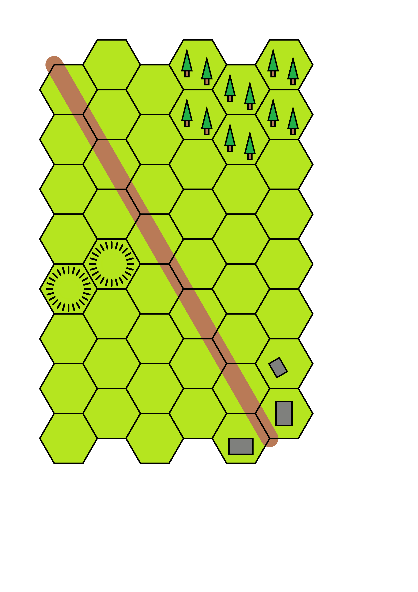

# HEXON Boards

## Background

These examples are derived from the boards created by Robert (Bob) Cordery
and available on his blog at
https://wargamingmiscellany.blogspot.com/search/label/Wargame%20Map%20Tool

He has kindly given me permission to reproduce the boards here.

"HEXON II" is the commercial name for terrain hexes designed for table-top
wargaming. Each hex is 100 mm (10 cm) from flat-edge to flat-edge. When
laid out, they form a map on which miniatures can maneover in a battle.

It can be useful to record a board layout, either for future use, or to share
with others, and **protograf** provides a straightforward way to do this.

## Approach

Because the maps share common terrain, it makes sense to place common colors
and terrain definitions in a common file for reuse by them.

From a code view, this file is then imported into the script creating the
board, and all its objects then become available.

So every board script starts:

```
from protograf import *
Create(...)
from terrain import *
```

The terrain import **must** happen after `Create()` in order for **protograf**
to properly process the code in that file.


## The Terrain File

The [terrain file](terrain.py) contains colors, common formatting for the
hills and rivers; and a custom Python function to draw all the elements
that make up the trees.


## Map No. 1

The [first map script](board_01.py) contains a roads, trees, towns and hills.

Some snippets from this file are shown below.

```python

# --- draw road
GridLine(
    hg,
    start="0508",
    point="e",
    edges="nw,"*10,
    stroke=ROAD,
    stroke_width=25,
    stroke_ends="rounded")

# ---- draw trees
trees(hg, "0401")

# ---- draw towns
Rectangle(
    height=0.8,
    width=0.6,
    x=hg.cxy("0607").x-0.6,
    y=hg.cxy("0607").y-0.2,
    rotation=30,
    fill=TOWN)

# ---- draw hills
Circle(common=hill, cxy=hg.cxy("0205"))
```

The original file looks as follows:


The file created by **protograf** looks as follows:



There is always some loss of quality in a bitmap image; so the PDF is the best
file to use as it contains scaleable vector graphics. Thus it can be shrunk or
enlarged with *no* loss of quality; see [Map 1 PDF](hexon01.pdf).


## Map No. 2

TODO!

## Map No. 3

TODO!
