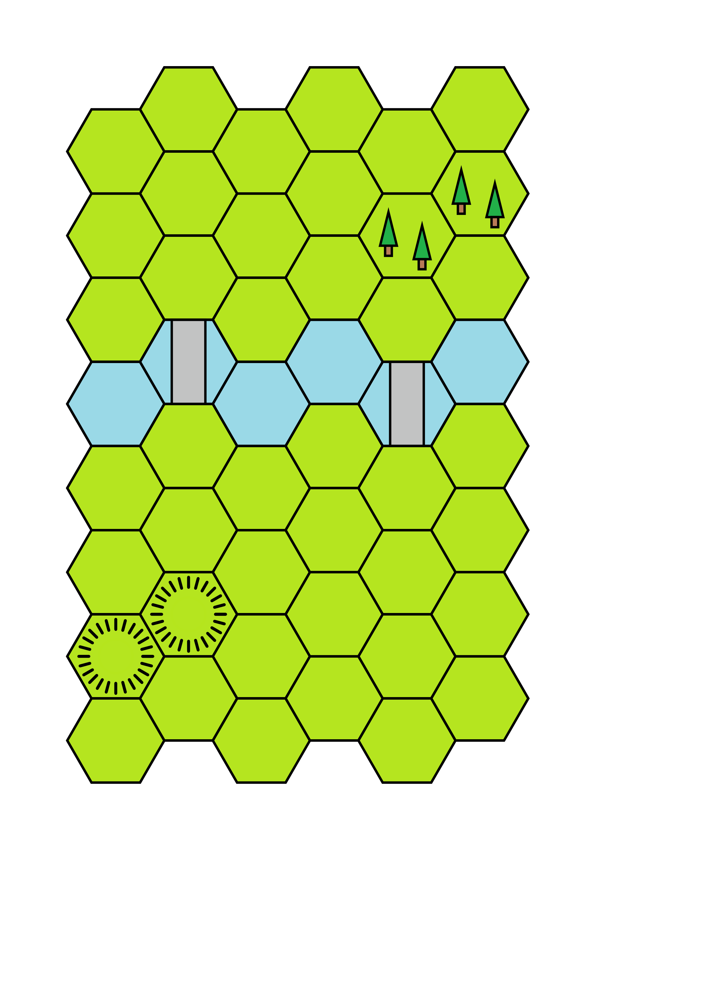
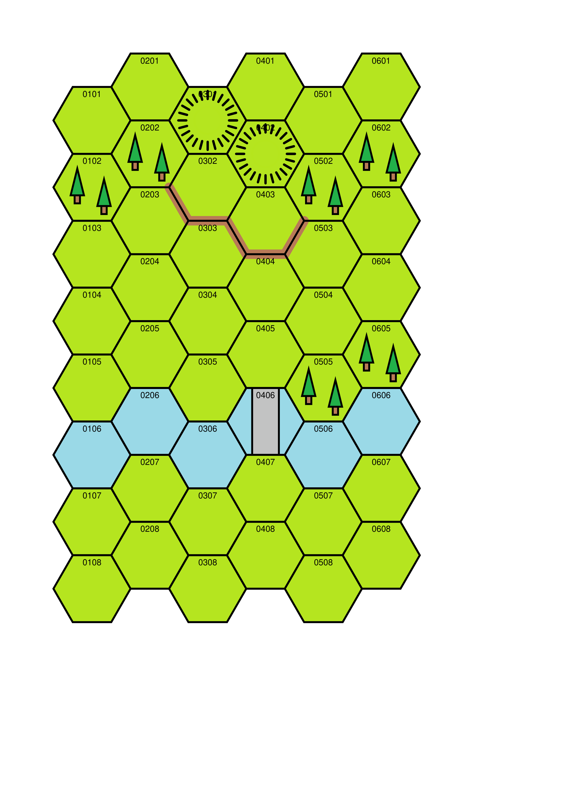

# HEXON II Boards

## Table of Contents

- [Background](#id-background)
- [Approach](#id-approach)
- [The Terrain File](#id-the-terrain-file)
- [Map One](#id-map-one)
- [Map Two](#id-map-two)
- [Map Three](#id-map-three)


<div id='id-background'/>
## Background

These examples are derived from the boards created by Robert (Bob) Cordery
and available on his blog at
https://wargamingmiscellany.blogspot.com/2026/07/wargame-map-tool-my-operation.html

He has kindly given me permission to reproduce the boards here.

"HEXON II" is the commercial name for terrain hexes designed for table-top
wargaming. Each hex is 100 mm (10 cm) from flat-edge to flat-edge. When
laid out, they form a map on which miniatures can maneuver in a battle.

It can be useful to record a board layout, either for future use, or to share
with others, and **protograf** provides a straightforward way to do this.

This example assumes you've gained some basic understanding of how **protograf**
works, and how you use *commands* to draw a series of elements, with custom
properties, onto a page.


<div id='id-approach'/>
## Approach

Because the maps share common terrain, it makes sense to place common colors
and terrain definitions in a common file for reuse by them.

From a code view, this file is then imported into the script creating the
board, and all its objects then become available.

So every board script starts:

```
from protograf import *
Create(...)
from terrain import *
```

The terrain import **must** happen after `Create()` in order for **protograf**
to properly process the code in that file.

Each map starts off the same way, by setting up a hexagonal grid using the
`Hexagons()` command.

```python

hg = Hexagons(common=grid, fill=HEXES)
```

<div id='id-the-terrain-file'/>
## The Terrain File

The [terrain file](terrain.py) contains colors, common properties for the
hills and rivers; and a custom Python function to draw all the elements
that make up the trees.

Colors are usually named based on their use or purpose, for example:

```python

HEXES = "#B5E51D"  # background green
RIVER = "#9AD9EA"  # blue
BRIDGE = "#C3C3C3"  # grey
```

Common properties are created via a `Common()` command, for example:

```python

# ---- bridge
bridge = Common(
    height=2.5,
    width=1,
    fill=BRIDGE,
    stroke="black",
    stroke_width=2,
    )
```

More complex terrain, such as the trees, which are composed of triangles and
rectangles, and appear multiple times in a hex, are grouped together in a
**function** and then that function is used in the script, passing in the
name assigned to the hexagonal grid along with the hex identification in
which the terrain (trees) must appear.

<div id='id-map-one'/>
## Map One

The [first map script](board_01.py) contains a road, trees, towns and hills.

Some snippets from this file are shown below.

```python

# --- draw road
GridLine(
    hg,
    start="0508",
    point="e",
    edges="nw,"*10,
    stroke=ROAD,
    stroke_width=25,
    stroke_ends="rounded")

# ---- draw trees
trees(hg, "0401")

# ---- draw towns
Rectangle(
    height=0.8,
    width=0.6,
    x=hg.cxy("0607").x-0.6,
    y=hg.cxy("0607").y-0.2,
    rotation=30,
    fill=TOWN)

# ---- draw hills
Circle(common=hill, cxy=hg.cxy("0205"))
```

A scaled down version of the original file looks as follows:


A scaled down version of the file created by **protograf** looks as follows:


There is always some loss of quality in a bitmap image; so the PDF is the best
file to use as it contains scaleable vector graphics. Thus it can be shrunk or
enlarged with *no* loss of quality; see [Map 1 PDF](hexon01.pdf).

<div id='id-map-two'/>
## Map Two

The [second map script](board_02.py) contains a river, bridges, trees and hills.

Some snippets from this file are shown below.

```python

# ---- draw trees
trees(hg, "0502")
trees(hg, "0602")

# ---- draw river
Hexagon(common=river, cxy=hg.cxy("0104"))
Hexagon(common=river, cxy=hg.cxy("0204"))

# ---- draw bridges
Rectangle(common=bridge, cxy=hg.cxy("0204"))
Rectangle(common=bridge, cxy=hg.cxy("0504"))

# ---- draw hills
Circle(common=hill, cxy=hg.cxy("0107"))
Circle(common=hill, cxy=hg.cxy("0207"))
```

A scaled down version of the original file looks as follows:


A scaled down version of the file created by **protograf** looks as follows:



There is always some loss of quality in a bitmap image; so the PDF is the best
file to use as it contains scaleable vector graphics. Thus it can be shrunk or
enlarged with *no* loss of quality; see [Map 2 PDF](hexon02.pdf).

<div id='id-map-three'/>
## Map Three

The [third map script](board_03.py) contains a river, a bridge, trees, hills
and a wall (or fortification line.)

Some snippets from this file are shown below.

```python

# ---- draw wall/fortification
GridLine(
    hg,
    start="0202",
    point="se",
    edges="se,e,se,e,ne",
    stroke=WALL,
    stroke_width=10,
    stroke_ends="rounded")

# ---- draw trees
trees(hg, "0102")
trees(hg, "0202")

# ---- draw hills
Circle(common=hill, cxy=hg.cxy("0301"))
Circle(common=hill, cxy=hg.cxy("0402"))

# ---- draw river
Hexagon(common=river, cxy=hg.cxy("0106"))
Hexagon(common=river, cxy=hg.cxy("0206"))

# ---- draw bridge
Rectangle(common=bridge, cxy=hg.cxy("0406"))
```

A scaled down version of the original file looks as follows:


A scaled down version of the file created by **protograf** looks as follows:



**NOTE** For this last map, the hex coordinates have drawn as well; this is
just one extra property in the ``Hexagons`` command, and is useful to leave
active while setting up the map:

```python

    coord_elevation="top"
```

There is always some loss of quality in a bitmap image; so the PDF is the best
file to use as it contains scaleable vector graphics. Thus it can be shrunk or
enlarged with *no* loss of quality; see [Map 3 PDF](hexon03.pdf).
